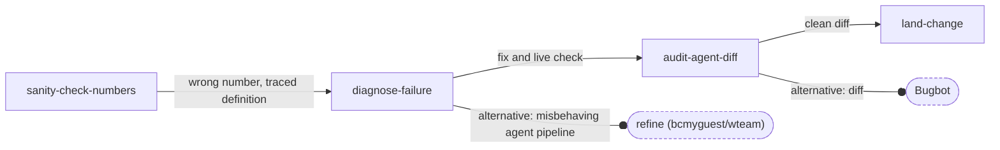
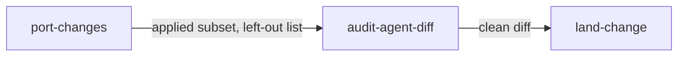
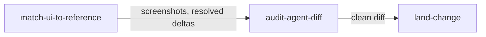
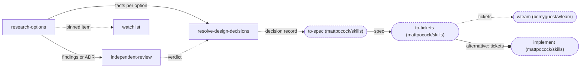
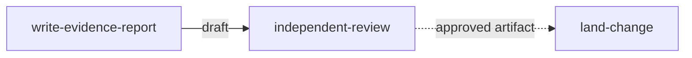
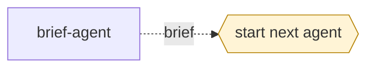

# Skill chains

<!-- Generated by scripts/chains.py from chains/skills.dot. Do not edit. -->

How the skills in this repo hand work to each other and to external skills.
Regenerate with `python3 scripts/chains.py`; verify with `python3 scripts/chains.py --check`.

## Legend

| Arrow | Relationship |
| --- | --- |
| `==>` solid, thick | prerequisite: the target needs the source's output first |
| `-->` solid | transition stated in the source skill's Next section |
| `-.->` dashed | suggested next step; it does not authorize running it |
| `--o` circle end, label starts "alternative:" | alternative to the source for a case it names |

Node shapes: rectangle = skill in this repo; rounded, dashed outline = external skill or tool;
hexagon = non-skill action (a person or host acts). Edge labels name the artifact passed.

## Full graph

```mermaid
flowchart LR
  diagnose_failure["diagnose-failure"]
  audit_agent_diff["audit-agent-diff"]
  refine(["refine (bcmyguest/wteam)"])
  sanity_check_numbers["sanity-check-numbers"]
  write_evidence_report["write-evidence-report"]
  port_changes["port-changes"]
  match_ui_to_reference["match-ui-to-reference"]
  land_change["land-change"]
  bugbot(["Bugbot"])
  research_options["research-options"]
  independent_review["independent-review"]
  resolve_design_decisions["resolve-design-decisions"]
  watchlist["watchlist"]
  to_spec(["to-spec (mattpocock/skills)"])
  to_tickets(["to-tickets (mattpocock/skills)"])
  wteam(["wteam (bcmyguest/wteam)"])
  implement(["implement (mattpocock/skills)"])
  plan_experiment["plan-experiment"]
  spend_approval{{"user approves spend"}}
  run_experiment["run-experiment"]
  brief_agent["brief-agent"]
  next_agent{{"start next agent"}}
  diagnose_failure -->|"fix and live check"| audit_agent_diff
  diagnose_failure --o|"alternative: misbehaving agent pipeline"| refine
  sanity_check_numbers -->|"wrong number, traced definition"| diagnose_failure
  sanity_check_numbers -->|"verified numbers"| write_evidence_report
  port_changes -->|"applied subset, left-out list"| audit_agent_diff
  match_ui_to_reference -->|"screenshots, resolved deltas"| audit_agent_diff
  audit_agent_diff -->|"clean diff"| land_change
  audit_agent_diff --o|"alternative: diff"| bugbot
  research_options -->|"findings or ADR"| independent_review
  research_options -->|"facts per option"| resolve_design_decisions
  research_options -.->|"pinned item"| watchlist
  independent_review -.->|"verdict"| resolve_design_decisions
  independent_review -.->|"approved artifact"| land_change
  resolve_design_decisions -.->|"decision record"| to_spec
  to_spec -->|"spec"| to_tickets
  to_tickets -.->|"tickets"| wteam
  to_tickets --o|"alternative: tickets"| implement
  plan_experiment -->|"pre-registered plan"| spend_approval
  plan_experiment ==>|"approved plan"| run_experiment
  spend_approval -->|"approved plan and caps"| run_experiment
  run_experiment -->|"result rows"| sanity_check_numbers
  run_experiment -.->|"stalled pipeline arm"| refine
  write_evidence_report -->|"draft"| independent_review
  brief_agent -.->|"brief"| next_agent
  classDef external stroke-dasharray: 4 3
  classDef action fill:#fff4d6,stroke:#b8860b
  class refine,bugbot,to_spec,to_tickets,wteam,implement external
  class spend_approval,next_agent action
```

## Workflows

### fix-defect

Runnable with wteam: `wteam run --team <path to this repo>/chains/teams/fix-defect.dot` (worker `diagnose-failure`, reviewers `audit-agent-diff`).

### experiment

```mermaid
flowchart LR
  sanity_check_numbers["sanity-check-numbers"]
  write_evidence_report["write-evidence-report"]
  plan_experiment["plan-experiment"]
  spend_approval{{"user approves spend"}}
  run_experiment["run-experiment"]
  refine(["refine (bcmyguest/wteam)"])
  independent_review["independent-review"]
  sanity_check_numbers -->|"verified numbers"| write_evidence_report
  plan_experiment -->|"pre-registered plan"| spend_approval
  plan_experiment ==>|"approved plan"| run_experiment
  spend_approval -->|"approved plan and caps"| run_experiment
  run_experiment -->|"result rows"| sanity_check_numbers
  run_experiment -.->|"stalled pipeline arm"| refine
  write_evidence_report -->|"draft"| independent_review
  classDef external stroke-dasharray: 4 3
  classDef action fill:#fff4d6,stroke:#b8860b
  class refine external
  class spend_approval action
```

### port

Runnable with wteam: `wteam run --team <path to this repo>/chains/teams/port.dot` (worker `port-changes`, reviewers `audit-agent-diff`).

### ui

Runnable with wteam: `wteam run --team <path to this repo>/chains/teams/ui.dot` (worker `match-ui-to-reference`, reviewers `audit-agent-diff`).

### decide-and-build

### report-review

Runnable with wteam: `wteam run --team <path to this repo>/chains/teams/report-review.dot` (worker `write-evidence-report`, reviewers `independent-review`).

### handoff

## Relationships

Origin: observed = seen in the work artifacts this library was built from; inferred = added during design.

| From | To | Relationship | Origin | Artifact | Source |
| --- | --- | --- | --- | --- | --- |
| `diagnose-failure` | `audit-agent-diff` | transition | observed | fix and live check | [skills/diagnose-failure/SKILL.md#next](skills/diagnose-failure/SKILL.md#next) |
| `diagnose-failure` | `refine` | alternative | inferred | misbehaving agent pipeline | [skills/diagnose-failure/SKILL.md#next](skills/diagnose-failure/SKILL.md#next) |
| `sanity-check-numbers` | `diagnose-failure` | transition | observed | wrong number, traced definition | [skills/sanity-check-numbers/SKILL.md#next](skills/sanity-check-numbers/SKILL.md#next) |
| `sanity-check-numbers` | `write-evidence-report` | transition | observed | verified numbers | [skills/sanity-check-numbers/SKILL.md#next](skills/sanity-check-numbers/SKILL.md#next) |
| `port-changes` | `audit-agent-diff` | transition | observed | applied subset, left-out list | [skills/port-changes/SKILL.md#next](skills/port-changes/SKILL.md#next) |
| `match-ui-to-reference` | `audit-agent-diff` | transition | observed | screenshots, resolved deltas | [skills/match-ui-to-reference/SKILL.md#next](skills/match-ui-to-reference/SKILL.md#next) |
| `audit-agent-diff` | `land-change` | transition | observed | clean diff | [skills/audit-agent-diff/SKILL.md#next](skills/audit-agent-diff/SKILL.md#next) |
| `audit-agent-diff` | `bugbot` | alternative | inferred | diff | [skills/audit-agent-diff/SKILL.md#next](skills/audit-agent-diff/SKILL.md#next) |
| `research-options` | `independent-review` | transition | observed | findings or ADR | [skills/research-options/SKILL.md#next](skills/research-options/SKILL.md#next) |
| `research-options` | `resolve-design-decisions` | transition | observed | facts per option | [skills/research-options/SKILL.md#next](skills/research-options/SKILL.md#next) |
| `research-options` | `watchlist` | suggested | inferred | pinned item | [skills/research-options/SKILL.md#next](skills/research-options/SKILL.md#next) |
| `independent-review` | `resolve-design-decisions` | suggested | inferred | verdict | [skills/independent-review/SKILL.md#next](skills/independent-review/SKILL.md#next) |
| `independent-review` | `land-change` | suggested | inferred | approved artifact | [skills/independent-review/SKILL.md#next](skills/independent-review/SKILL.md#next) |
| `resolve-design-decisions` | `to-spec` | suggested | inferred | decision record | [skills/resolve-design-decisions/SKILL.md#next](skills/resolve-design-decisions/SKILL.md#next) |
| `to-spec` | `to-tickets` | transition | inferred | spec | [skills/resolve-design-decisions/SKILL.md#next](skills/resolve-design-decisions/SKILL.md#next) |
| `to-tickets` | `wteam` | suggested | inferred | tickets | [skills/resolve-design-decisions/SKILL.md#next](skills/resolve-design-decisions/SKILL.md#next) |
| `to-tickets` | `implement` | alternative | inferred | tickets | [skills/resolve-design-decisions/SKILL.md#next](skills/resolve-design-decisions/SKILL.md#next) |
| `plan-experiment` | `spend-approval` | transition | observed | pre-registered plan | [skills/plan-experiment/SKILL.md#next](skills/plan-experiment/SKILL.md#next) |
| `plan-experiment` | `run-experiment` | prerequisite | observed | approved plan | [skills/plan-experiment/SKILL.md#next](skills/plan-experiment/SKILL.md#next) |
| `spend-approval` | `run-experiment` | transition | observed | approved plan and caps | [skills/run-experiment/SKILL.md#method](skills/run-experiment/SKILL.md#method) |
| `run-experiment` | `sanity-check-numbers` | transition | observed | result rows | [skills/run-experiment/SKILL.md#next](skills/run-experiment/SKILL.md#next) |
| `run-experiment` | `refine` | suggested | inferred | stalled pipeline arm | [skills/run-experiment/SKILL.md#next](skills/run-experiment/SKILL.md#next) |
| `write-evidence-report` | `independent-review` | transition | inferred | draft | [skills/write-evidence-report/SKILL.md#next](skills/write-evidence-report/SKILL.md#next) |
| `brief-agent` | `next-agent` | suggested | inferred | brief | [skills/brief-agent/SKILL.md#next](skills/brief-agent/SKILL.md#next) |

## Not skills in this repo

| Node | Type | What |
| --- | --- | --- |
| `wteam` | external | wteam (bcmyguest/wteam) |
| `refine` | external | refine (bcmyguest/wteam) |
| `to-spec` | external | to-spec (mattpocock/skills) |
| `to-tickets` | external | to-tickets (mattpocock/skills) |
| `implement` | external | implement (mattpocock/skills) |
| `bugbot` | external | Bugbot |
| `spend-approval` | action | user approves spend |
| `next-agent` | action | start next agent |

## Unconnected skills

- `add-ansible-role`
- `assign-mr-reviewers`
- `debug-lemonade`
- `efficiency-audit`
- `pre-commit-setup`
- `react-ts-setup`
- `release-setup`
- `rigs`
- `rust-setup`
- `security-audit`
- `senior-frontend-refactor`
- `uv-develop`
- `uv-setup`
