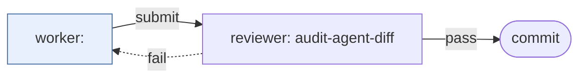
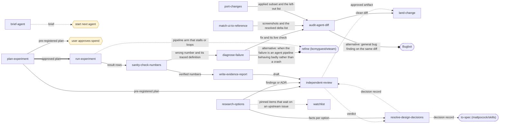

# Skill chains

<!-- Generated by scripts/chains.py from wteam/teams/ and each skill's ## Next. Do not edit. -->

Teams are runnable [wteam](https://github.com/bcmyguest/wteam) teams in `wteam/teams/`.
Install them with `scripts/install-wteam.sh`, then `wteam run --pairs N --team <name>`.
A ticket walks every step of its team and commits once, after the last review passes.
Hand-offs are what each skill's `## Next` section states, inside or outside a team.
Regenerate with `python3 scripts/chains.py`; verify with `python3 scripts/chains.py --check`.

## Teams

### change

Make a change a reviewer can check against the diff: fix a defect, port selected work, or match a UI to a reference. The planner sets each ticket's Skill: (diagnose-failure, port-changes, or match-ui-to-reference). Reviewed with audit-agent-diff.

Path: the ticket's skill → `audit-agent-diff` (review).

### experiment

Plan an experiment, get the user's spend approval, run it, check the numbers, and write up what the evidence supports. Steps: plan-experiment, approval gate, run-experiment (checked with sanity-check-numbers), write-evidence-report (reviewed with independent-review). A ticket whose results already exist starts at report.

Path: `plan-experiment` → `independent-review` (review) → gate *user approves spend* → `run-experiment` → `sanity-check-numbers` (review) → `write-evidence-report` → `independent-review` (review).

```mermaid
flowchart LR
  plan["plan: plan-experiment"]
  plan_review["plan_review: independent-review"]
  spend_approval{{"user approves spend"}}
  run["run: run-experiment"]
  run_review["run_review: sanity-check-numbers"]
  report["report: write-evidence-report"]
  report_review["report_review: independent-review"]
  done(["commit"])
  plan -->|submit| plan_review
  plan_review -->|pass| spend_approval
  spend_approval -->|pass| run
  run -->|submit| run_review
  run_review -->|pass| report
  report -->|submit| report_review
  report_review -->|pass| done
  plan_review -.->|fail| plan
  run_review -.->|fail| run
  report_review -.->|fail| report
  classDef step fill:#e8f0fe,stroke:#4a6fa5
  class plan,run,report step
```

## Hand-offs

| Arrow | Relationship |
| --- | --- |
| `==>` solid, thick | prerequisite: the target needs the source's output first |
| `-->` solid | transition stated in the source skill's Next section |
| `-.->` dashed | suggested next step; it does not authorize running it |
| `--o` circle end, label starts "alternative:" | alternative to the source for a case it names |

Node shapes: rectangle = skill in this repo; rounded, dashed outline = external skill or tool;
hexagon = non-skill action (a person or host acts). Edge labels name the artifact passed.

| From | To | Relationship | Artifact |
| --- | --- | --- | --- |
| `audit-agent-diff` | `land-change` | transition | the clean diff. |
| `audit-agent-diff` | `bugbot` | alternative | general bug finding on the same diff. |
| `brief-agent` | `next-agent` | suggested | the brief. |
| `diagnose-failure` | `audit-agent-diff` | transition | the fix and its live check, before it lands. |
| `diagnose-failure` | `refine` | alternative | when the failure is an agent pipeline behaving badly rather than a crash. |
| `independent-review` | `resolve-design-decisions` | suggested | the verdict, when it leaves a choice open. |
| `independent-review` | `land-change` | suggested | the approved artifact. |
| `match-ui-to-reference` | `audit-agent-diff` | transition | screenshots and the resolved delta list. |
| `plan-experiment` | `independent-review` | transition | the pre-registered plan, for a fresh-context read before spend. |
| `plan-experiment` | `spend-approval` | transition | the pre-registered plan. |
| `plan-experiment` | `run-experiment` | prerequisite | the approved plan. |
| `port-changes` | `audit-agent-diff` | transition | the applied subset and the left-out list. |
| `research-options` | `independent-review` | transition | the findings or ADR, for an adversarial read. |
| `research-options` | `resolve-design-decisions` | transition | facts per option, when a choice is left for the user. |
| `research-options` | `watchlist` | suggested | pinned items that wait on an upstream issue, PR, or release. |
| `resolve-design-decisions` | `independent-review` | suggested | the decision record, for a fresh-context read. |
| `resolve-design-decisions` | `to-spec` | suggested | the decision record, when the work needs a written spec. |
| `run-experiment` | `sanity-check-numbers` | transition | the result rows. |
| `run-experiment` | `refine` | suggested | a pipeline arm that stalls or loops. |
| `sanity-check-numbers` | `diagnose-failure` | transition | the wrong number and its traced definition, when the cause is a bug. |
| `sanity-check-numbers` | `write-evidence-report` | transition | verified numbers, ready to publish. |
| `write-evidence-report` | `independent-review` | transition | the draft. |

## Not skills in this repo

| Node | Type | What |
| --- | --- | --- |
| `wteam` | external | wteam (bcmyguest/wteam) |
| `refine` | external | refine (bcmyguest/wteam) |
| `bugbot` | external | Bugbot |
| `to-spec` | external | to-spec (mattpocock/skills) |
| `spend-approval` | action | user approves spend |
| `next-agent` | action | start next agent |

## Unconnected skills

- `add-ansible-role`
- `assign-mr-reviewers`
- `debug-lemonade`
- `efficiency-audit`
- `pre-commit-setup`
- `react-ts-setup`
- `release-setup`
- `rigs`
- `rust-setup`
- `security-audit`
- `senior-frontend-refactor`
- `uv-develop`
- `uv-setup`
