# personal-skills

Portable [agent skills](https://skills.sh) — one `SKILL.md` per skill,
in the open skills format that any modern coding agent reads (Claude Code, Codex,
opencode, Cursor, …). The repo itself is the package; GitHub is the registry.

## Install

```bash
npx skills add bcmyguest/personal-skills          # pick skills + agents interactively
npx skills add bcmyguest/personal-skills --all    # every skill -> every detected agent
npx skills add bcmyguest/personal-skills -a claude-code -a codex -a opencode
npx skills update                                  # pull later updates
```

`skills` symlinks each skill into your agent's native skills directory (single source of
truth, easy updates), or copies with `--copy` where symlinks aren't supported. See
[vercel-labs/skills](https://github.com/vercel-labs/skills).

Without installing, point an agent at the file: "Follow `skills/diagnose-failure/SKILL.md`
from bcmyguest/personal-skills."

## Skills

| Skill | What |
|-------|------|
| `diagnose-failure` | Find and fix the actual cause of a failure, with fast and strict paths |
| `sanity-check-numbers` | Decide whether a metric, score, or cost is real before trusting it |
| `audit-agent-diff` | Check an agent-written diff for overreach before it lands |
| `land-change` | Commit, push, PR, and merge exactly the intended change |
| `port-changes` | Bring selected work across branches, PRs, or archives |
| `match-ui-to-reference` | Converge a UI on a design through numbered deltas and screenshots |
| `resolve-design-decisions` | Settle costly-to-reverse choices in dependency-ordered question rounds |
| `research-options` | Compare options with primary sources and spikes |
| `independent-review` | Get a verdict from a reviewer that did not write the artifact |
| `brief-agent` | Write a self-contained brief for the next agent or session |
| `plan-experiment` | Pre-register a comparison before spending on it |
| `run-experiment` | Run an approved plan, monitor it, and keep it resumable |
| `write-evidence-report` | Publish results that say exactly what the evidence supports |
| `uv-setup` | Scaffold a Python repo with uv from shipped templates — CI, auto-releases, PyPI Trusted Publishing |
| `uv-develop` | Corrective uv operations — targeted upgrades, `--locked` vs `--frozen`, venv repair |
| `pre-commit-setup` | Stand up pre-commit from shipped fragments — hygiene + Conventional Commits + hook-update policy |
| `release-setup` | Release automation from Conventional Commits — canonical git-cliff config + GitLab tag/release pipeline |
| `watchlist` | Track upstream GitHub issues, PRs, and releases |
| `assign-mr-reviewers` | Assign CODEOWNERS reviewers to your open GitLab MRs |
| `rigs` | Install OpenRig, hand a goal to its operator, and follow a coding-agent team's work (vendored from OpenRig 0.6.7) |
| `react-ts-setup` | Scaffold a React + TypeScript repo with Vite + full toolchain |
| `rust-setup` | Scaffold a Rust repo from shipped templates — CI, auto-releases, crates.io Trusted Publishing |
| `senior-frontend-refactor` | Refactor frontend code as a senior engineer |
| `add-ansible-role` | Add a tool-install role to a personal Ansible playbook |
| `debug-lemonade` | Diagnose lemonade-server on the Strix Halo box |
| `security-audit` | Find and adversarially verify a codebase's 1–3 worst security vulnerabilities (capped Sonnet multi-agent workflow) |
| `efficiency-audit` | Find and verify a codebase's 1–3 worst efficiency problems with concrete cost analyses (capped Sonnet multi-agent workflow) |

Layout: one folder per skill under [`skills/`](skills), each with a `SKILL.md` plus any
resources it needs (`references/`, `templates/`, `config.json`).

`writing-with-clarity` moved to [bcmyguest/claude-memory](https://github.com/bcmyguest/claude-memory);
`fast-hypothesis` and `reproduce-bug` are folded into `diagnose-failure`.

## Skill chains

Edit relationships in [`chains/skills.dot`](chains/skills.dot) and each skill's `## Next`
section, then regenerate and check:

```bash
python3 scripts/chains.py            # writes CHAINS.md, this section, chains/teams/*.dot
python3 scripts/chains.py --check    # CI-style: fails on stale output or registry errors
python3 scripts/chains.py --check --wteam   # also parses every DOT file with wteam
python3 scripts/test_chains.py       # check-mode and routing-example tests
```

Run a generated team in a project with
`wteam run --team ~/personal-skills/chains/teams/fix-defect.dot`.

```mermaid
flowchart LR
  diagnose_failure["diagnose-failure"]
  audit_agent_diff["audit-agent-diff"]
  refine(["refine (bcmyguest/wteam)"])
  sanity_check_numbers["sanity-check-numbers"]
  write_evidence_report["write-evidence-report"]
  port_changes["port-changes"]
  match_ui_to_reference["match-ui-to-reference"]
  land_change["land-change"]
  bugbot(["Bugbot"])
  research_options["research-options"]
  independent_review["independent-review"]
  resolve_design_decisions["resolve-design-decisions"]
  watchlist["watchlist"]
  to_spec(["to-spec (mattpocock/skills)"])
  to_tickets(["to-tickets (mattpocock/skills)"])
  wteam(["wteam (bcmyguest/wteam)"])
  implement(["implement (mattpocock/skills)"])
  plan_experiment["plan-experiment"]
  spend_approval{{"user approves spend"}}
  run_experiment["run-experiment"]
  brief_agent["brief-agent"]
  next_agent{{"start next agent"}}
  diagnose_failure -->|"fix and live check"| audit_agent_diff
  diagnose_failure --o|"alternative: misbehaving agent pipeline"| refine
  sanity_check_numbers -->|"wrong number, traced definition"| diagnose_failure
  sanity_check_numbers -->|"verified numbers"| write_evidence_report
  port_changes -->|"applied subset, left-out list"| audit_agent_diff
  match_ui_to_reference -->|"screenshots, resolved deltas"| audit_agent_diff
  audit_agent_diff -->|"clean diff"| land_change
  audit_agent_diff --o|"alternative: diff"| bugbot
  research_options -->|"findings or ADR"| independent_review
  research_options -->|"facts per option"| resolve_design_decisions
  research_options -.->|"pinned item"| watchlist
  independent_review -.->|"verdict"| resolve_design_decisions
  independent_review -.->|"approved artifact"| land_change
  resolve_design_decisions -.->|"decision record"| to_spec
  to_spec -->|"spec"| to_tickets
  to_tickets -.->|"tickets"| wteam
  to_tickets --o|"alternative: tickets"| implement
  plan_experiment -->|"pre-registered plan"| spend_approval
  plan_experiment ==>|"approved plan"| run_experiment
  spend_approval -->|"approved plan and caps"| run_experiment
  run_experiment -->|"result rows"| sanity_check_numbers
  run_experiment -.->|"stalled pipeline arm"| refine
  write_evidence_report -->|"draft"| independent_review
  brief_agent -.->|"brief"| next_agent
  classDef external stroke-dasharray: 4 3
  classDef action fill:#fff4d6,stroke:#b8860b
  class refine,bugbot,to_spec,to_tickets,wteam,implement external
  class spend_approval,next_agent action
```

<!-- chains:start -->
<!-- Generated by scripts/chains.py. Do not edit. -->



Solid arrows are transitions a skill states, dashed arrows are suggestions, and circle-ended arrows are alternatives. [CHAINS.md](CHAINS.md) has the legend, one diagram per workflow, the runnable wteam teams, and where each relationship comes from.

Skills with no chain: `add-ansible-role`, `assign-mr-reviewers`, `debug-lemonade`, `efficiency-audit`, `pre-commit-setup`, `react-ts-setup`, `release-setup`, `rigs`, `rust-setup`, `security-audit`, `senior-frontend-refactor`, `uv-develop`, `uv-setup`.
<!-- chains:end -->

The portable `handoff` and `pickup` skills moved to their own repo —
[bcmyguest/baton](https://github.com/bcmyguest/baton) (`npx skills add bcmyguest/baton`).

## Claude Code plugins (hook-bearing — not plain skills)

Some tools need a hook, which the portable skills format can't carry. Those are Claude
Code plugins and now live in their own repos:

| Plugin | What | Repo |
|--------|------|------|
| `assisted-by` | `git-attribution` skill **plus** a PreToolUse hook that enforces AI commit attribution on `git commit` | [bcmyguest/assisted-by](https://github.com/bcmyguest/assisted-by) |
| `skill-inject` | Local, model-agnostic automatic skill injection | [bcmyguest/skill-injector](https://github.com/bcmyguest/skill-injector) |
| `claude-memory` | Session conventions (MEMORY.md) plus `/install` script for `@include` injection | [bcmyguest/claude-memory](https://github.com/bcmyguest/claude-memory) |

```bash
claude plugin marketplace add bcmyguest/assisted-by
claude plugin install assisted-by@assisted-by
```

## Bootstrap my own machine

For my own setup, [`install-plugins.sh`](install-plugins.sh) is an idempotent
bootstrap that registers the `assisted-by`, `caveman`, and `anthropic-agent-skills`
GitHub marketplaces, then installs and enables the plugins listed in
[`plugins.json`](plugins.json). It does **not** install the portable `skills/` — use
`npx skills` above for those.

```bash
git clone git@github.com:bcmyguest/personal-skills.git ~/personal-skills
~/personal-skills/install-plugins.sh
```

## Layout

Two tracks: portable skills install with `npx skills`; hook-bearing plugins install
through the Claude Code marketplace.

```
skills/                          # portable agent skills — one folder per skill (npx skills)
  uv-setup/                  SKILL.md + templates/
  uv-develop/                SKILL.md
  pre-commit-setup/          SKILL.md + templates/
  release-setup/             SKILL.md + templates/
  watchlist/                 SKILL.md
  assign-mr-reviewers/       SKILL.md + scripts/
  react-ts-setup/            SKILL.md + references/
  rust-setup/                SKILL.md + templates/
  senior-frontend-refactor/  SKILL.md
  add-ansible-role/          SKILL.md + config.json + templates/
  debug-lemonade/            SKILL.md
  diagnose-failure/ … write-evidence-report/   SKILL.md each (method skills, see CHAINS.md)
  security-audit/            SKILL.md + scripts/ + evals/
  efficiency-audit/          SKILL.md + scripts/ + evals/
  _fixtures/                 shared eval fixture (vuln-app) for the audit skills
skills.sh.json                   # skills.sh groupings for the skills above
plugins.json                     # external marketplaces + enable list for install-plugins.sh
install-plugins.sh               # personal-machine bootstrap (hook-bearing plugins)
IDEAS.md                         # parked skill candidates and config snippets
chains/skills.dot                # skill relationship registry (DOT, wteam subset)
chains/teams/                    # generated wteam teams for runnable workflows
chains/routing.md                # routing examples and near-misses per skill
scripts/chains.py                # renders CHAINS.md, the Skill chains section, chains/teams/
CHAINS.md                        # generated: legend, graphs, relationship table
DECISIONS.md                     # why the method skills look the way they do
```

## License

See [LICENSE](LICENSE). All rights reserved; in particular, the contents may **not** be
used as training, fine-tuning, or evaluation data for machine-learning or AI systems.
